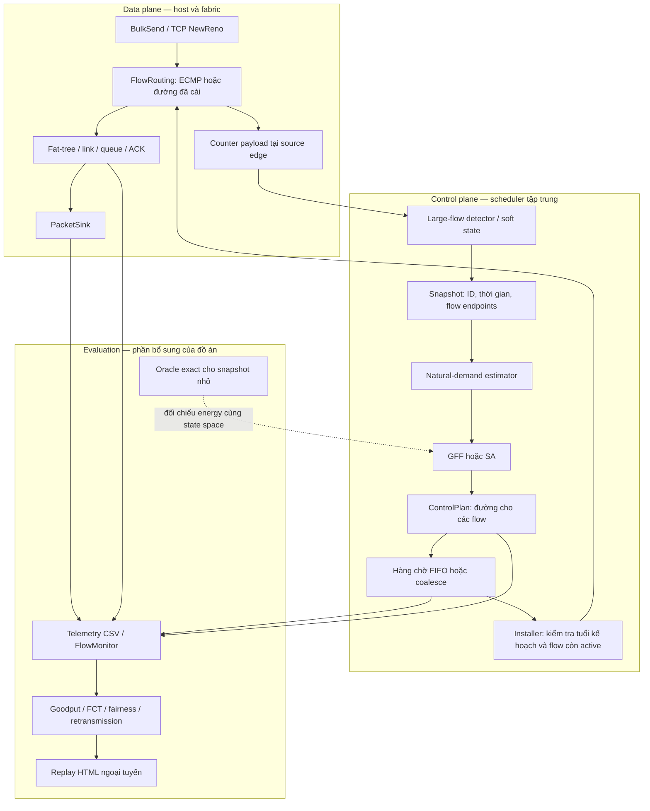

# Kiến trúc Hedera trong project ns-3

## Cách tổ chức theo paper

[Hedera, NSDI 2010, §3](https://www.usenix.org/legacy/event/nsdi10/tech/full_papers/al-fares.pdf) mô tả vòng phát hiện flow lớn tại edge, ước lượng và lập lịch tập trung, rồi cài đường. Project tổ chức các trách nhiệm đó thành **data plane** và **control plane**. Monitoring là module tại ranh giới hai plane. Phần evaluation/replay là công cụ của đồ án; không gán nó thành một plane do paper định nghĩa.



## Module thực tế và hợp đồng dữ liệu

| Thành phần | Source | Trách nhiệm và dữ liệu được phép dùng |
|---|---|---|
| Khởi tạo / vòng đời | `sim/hedera-network.cc` | Xác thực Settings, nối module, mở log, chạy/dừng ns-3. |
| Data plane | `sim/hedera-data-plane.cc` | Topology, IPv4 routing, ECMP hash, path version, đọc header và ghi nhận quan sát source-edge. Không giải bài toán placement. |
| Monitoring | `sim/hedera-monitoring.{h,cc}` | Counter payload, tốc độ từng kỳ, threshold, FIN/RST và idle expiry. Chỉ dùng thông tin quan sát được ở switch. |
| Control plane | `sim/hedera-control-plane.cc` | Lấy snapshot, gọi estimator và GFF/SA, tạo kế hoạch, điều phối hàng chờ và cài đường. |
| State của hàng chờ | `sim/hedera-controller.{h,cc}` | Hàng chờ thuần C++, không phụ thuộc ns-3; một kế hoạch đang phục vụ, nhiều kế hoạch chờ tùy policy. |
| Thuật toán | `sim/hedera-core.{h,cc}` | FatTree, EstimateDemands, GlobalFirstFit, Anneal, ComputeLoads, Energy. |
| Sinh ứng dụng | `sim/hedera-workload.cc` | CSV workload, start/stop theo flow, cohort, phases, BulkSend/PacketSink. Đây là simulation harness. |
| Telemetry | `sim/hedera-telemetry.cc` | Counter nhận, TCP trace, queue drop, link utilization và xuất kết quả. Dữ liệu đánh giá không được dùng làm oracle cho controller. |
| Exact oracle | `sim/hedera-oracle.{h,cc}` | Executable kiểm chứng riêng; không liên kết vào đường xử lý packet và không chọn đường thay scheduler trong thí nghiệm mạng. |
| Phân tích / replay | `scripts/metrics.py`, `scripts/analyze-benchmarks.py`, `scripts/export-replay.py`, `web/replay.html` | Đọc output đã có, giữ đơn vị/cohort/cửa sổ và dựng kết quả. Không tác động simulation. |

Header `hedera-network.h` giữ façade nối các adapter ns-3. Việc tách file làm rõ chủ sở hữu trách nhiệm; các module ns-3 vẫn thuộc một process mô phỏng, không phải dịch vụ mạng hay controller độc lập thật.

### Từ monitoring tới controller

`FlowCounters` lưu byte payload đã thấy, thời điểm hoạt động gần nhất, cờ FIN/RST, tốc độ đo và lần đầu được nhận diện là flow lớn. `PollLargeFlow` chọn tập flow theo threshold và soft state. Nó không đọc `rx_bytes`, FCT, kích thước file hay thời điểm ứng dụng được cấu hình dừng để quyết định flow còn active.

Estimator nhận các cặp nguồn–đích của tập flow được chọn. Chế độ ablation measured dùng counter source-edge. Cả hai mode không đọc counter sink để đoán nhu cầu.

### Từ controller xuống data plane

Mỗi `ControlPlan` có ID tăng đơn điệu, thời điểm snapshot và các đường dự kiến. Sau thời gian phục vụ, installer kiểm tra tuổi kế hoạch nếu bật `maxPlanAge`; từng flow còn phải hợp lệ theo FIN/RST/idle soft state. Flow đã ngừng ứng dụng vẫn có thể còn dữ liệu trong TCP buffer; source stop vì vậy không tự động đồng nghĩa flow đã hết hoạt động ở switch.

Data plane dùng tag phiên bản tại source edge để packet đang đi giữ đường của nó. Tag là metadata của simulator. Không mô hình OpenFlow message, TCAM, cập nhật từng switch hoặc xác nhận cài rule thật.

## Hai chế độ hàng chờ

- `controlPolicy=fifo`: giữ mọi snapshot theo thứ tự. Nếu `controlDelay > interval`, hàng chờ có thể tăng và snapshot được cài có thể cũ.
- `controlPolicy=coalesce`: giữ kế hoạch đang phục vụ và tối đa một kế hoạch đang chờ; snapshot mới thay kế hoạch chờ cũ. Không hủy kế hoạch đang phục vụ, nên không trì hoãn cài đặt vô hạn khi các snapshot tiếp tục đến.
- `maxPlanAge=0`: không giới hạn tuổi. Giá trị dương đặt thời gian tối đa tính từ snapshot đến lúc hoàn tất phục vụ; kế hoạch quá hạn bị bỏ.

`controlDelay` ở bản mới là **thời gian phục vụ/cài đặt cố định cho một kế hoạch trong hàng chờ tuần tự**. Khi delay nhỏ hơn interval và hàng chờ rỗng, thời điểm cài khớp mô hình cũ. Khi delay lớn, project chủ động mô hình hóa backlog. Đây là mở rộng của đồ án, không tuyên bố là mô hình timing nguyên gốc của paper.

CPU wall time của estimator/SA được đo riêng và không tự cộng vào simulated time. Hàng chờ chưa mô hình số byte telemetry, độ trễ từng switch hay giới hạn tốc độ thông điệp OpenFlow. State reservation/mapping là state kế hoạch của scheduler; các đường thật đã cài được theo dõi riêng trong data plane và log.

`control-events.csv` ghi `submit`, `start`, `replaced`, `flow_install`, `install`, `expired`, `skip_inactive`, kèm plan ID, snapshot time và tuổi. Kế hoạch chưa hoàn tất khi Simulator::Stop vẫn được công bố trong `pending_plans_at_stop`.

## Workload theo pha

`--workload=phased --trafficMode=sustained --k=4` tạo fixture có chủ đích gồm ba pha:

1. Bốn flow background tồn tại suốt lần chạy, đường ECMP ban đầu phân bố theo bốn core.
2. Bốn flow burst từ những nguồn khác bắt đầu ở `duration/3`, cùng chọn core 0 trên baseline ECMP.
3. Nguồn burst dừng ở `2*duration/3`; background tiếp tục. Dữ liệu còn trong buffer có thể tiếp tục đi sau source stop.

Fixture tìm TCP destination port để tạo đường ban đầu, đồng thời kiểm tra giả định ephemeral source port tại packet đầu. Không dùng fixture này để suy rộng hiệu quả sang traffic ngẫu nhiên.

CSV mới: `src,dst,start,bytes,port,stop,cohort`. CSV cũ 4/5 cột vẫn đọc được; `stop` thiếu mặc định bằng duration. Với sustained, `bytes=0` nghĩa BulkSend không giới hạn byte. Cohort là nhãn đánh giá, không đưa vào thuật toán chọn đường.

`phases.csv` mô tả các pha của generator; `workload-events.csv` công bố thời điểm cấu hình source start/stop. Replay CSV có thể dùng lại các thời điểm và cohort. File phases là metadata riêng; khi dùng CSV tự tạo, người dùng có thể cung cấp `phases.csv` tương ứng cho phân tích ngoại tuyến.

## Ý nghĩa các metric bổ sung

- Goodput từng flow: byte PacketSink giao cho ứng dụng trong cùng cửa sổ chia thời lượng cửa sổ. Không chuẩn hóa theo thời gian active riêng của từng flow rồi trộn vào tổng.
- Fairness Jain: chỉ công bố cho flow sustained có nguồn hoạt động trọn cửa sổ đo; giữ cả thành viên có zero goodput. Công bố số flow và cohort. Đây không phải chỉ tiêu fairness phù hợp cho mọi offered load hữu hạn.
- Mean/p95 FCT: điều kiện trên các flow hữu hạn đã hoàn thành; luôn giữ số cohort và tỷ lệ hoàn thành. Không gán flow chưa xong FCT bằng 0.
- Retransmission/drop trong cửa sổ: chỉ công bố khi có diagnostics; thiếu trace là `null`, không biến thành 0. Queue-disc drop được tách data/ACK, chưa bao gồm mọi loại device/IP drop.
- Recovery: xem goodput của background, bỏ bucket vắt qua ranh giới pha; sau burst, tìm ba bucket liên tiếp đạt ít nhất 95% baseline background. Nếu mean background không suy giảm ở pha burst thì ghi trạng thái tương ứng thay vì nhận có một lần phục hồi. Không quan sát đủ trước khi dừng thì giữ `null`.
- First reroute: có thể không xuất hiện vì baseline đã phù hợp hoặc flow không cần đổi đường; `null` không tự mang nghĩa lỗi.

## Oracle và phạm vi tối ưu

`ExactDestinationCore` duyệt tất cả phép gán core cho các đích liên pod đang có flow, giữ điều kiện một-một trong từng pod. Phần đích không active được điền thành một hoán vị chuẩn; các hoán vị khác của phần này không đổi đường của flow đang xét. Không có pruning theo quality hoặc dừng sớm sau khi tìm H=0. Nếu số state vượt giới hạn, hàm từ chối trước khi duyệt, không trả một nghiệm cắt ngắn dưới nhãn exact.

Oracle dùng cùng objective H và cùng không gian state với SA. Nó không phải tối ưu đường độc lập từng flow, không phải oracle FCT/goodput, và chưa chứng minh approximation ratio của Hedera. Thí nghiệm có một case demand vượt NIC được gắn nhãn synthetic để kiểm tra H* dương, không nhận đó là đầu ra estimator.

`extract-oracle-snapshot.py` lấy một tick đầy đủ từ `controller-flows.csv`, giữ demand và baseline để chạy lại oracle. Study SA kiểm tra delta bằng tính energy đầy đủ ở từng bước; vì vậy cột `sa_ms` không đại diện runtime tối ưu dùng cho microbenchmark scheduler trước đó.

## Kiểm tra và chạy lại

```bash
cd /path/to/Hedera
bash scripts/run-upgrade-study.sh
```

Lệnh tạo output mới có timestamp, build/test core, chạy oracle, dynamic, control-lifecycle, demo và acceptance; tổng hợp metric, PNG và replay. Có thể truyền một thư mục output mới làm đối số đầu tiên. Kết quả cũ không bị ghi đè.

Các file replay chứa dữ liệu đã nhúng, không cần server hoặc CDN. Mở bằng trình duyệt hỗ trợ HTML/SVG/JavaScript. Chọn run, flow, kéo thời gian hoặc nhấn Phát. Tải link là số đo từ CSV; đường nét đứt là proposal gần nhất trong log, có thể đã bị thay hoặc quá hạn, không mặc định đó là kế hoạch sẽ được cài.
